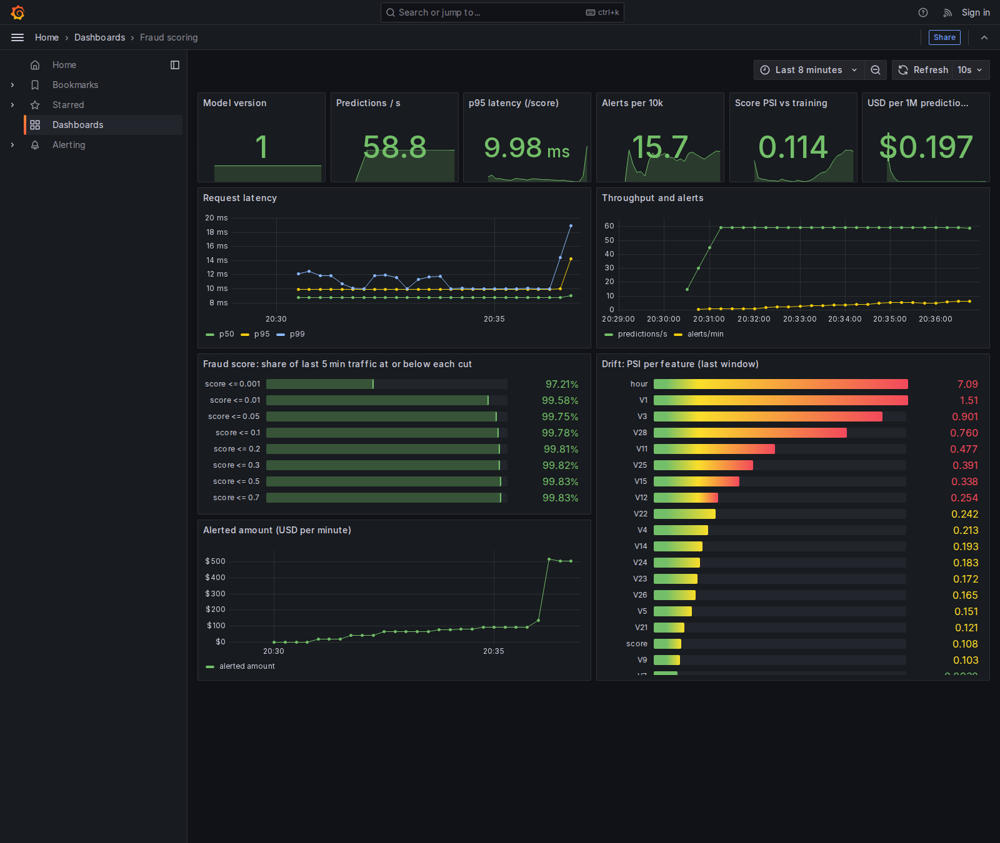
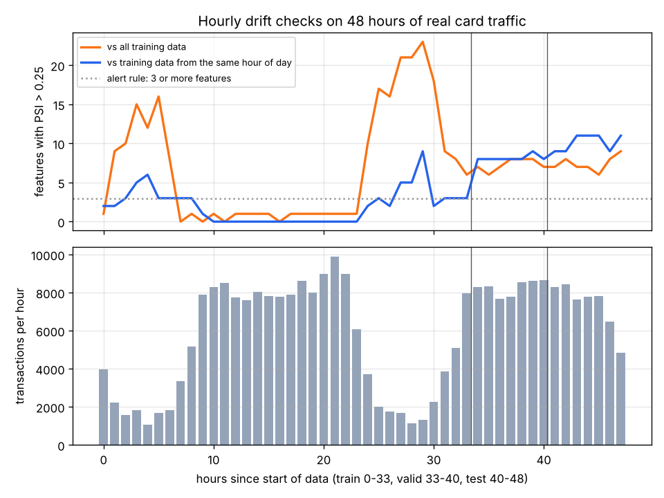
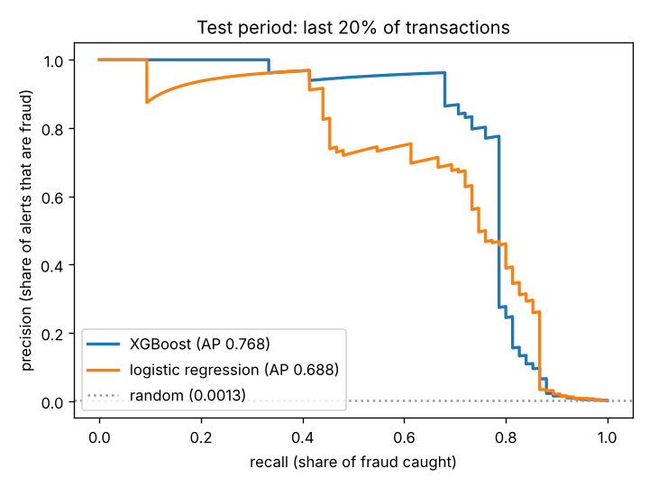

# Real-Time Card Fraud Scoring: an End-to-End MLOps Pipeline

[](https://github.com/bu09572-gif/realtime-fraud-scoring/actions/workflows/cicd.yml)

A fraud model that is trained, checked, registered, shipped in a container, and watched in production. Every card transaction gets a fraud probability, an alert decision and the three features that pushed its score the most. Everything here runs on real card transactions and free tools.

What it covers:

- **Training pipeline** with data checks, MLflow experiment tracking, a model registry, and a promotion gate that a new model must pass before it replaces the current one
- **Serving** as a FastAPI service in Docker, with Prometheus metrics for latency, throughput, alert rate, score distribution, drift and cost
- **Monitoring**: a Grafana dashboard, alert rules, and a drift check against the training data
- **CI/CD** in GitHub Actions: tests, retrain and reproducibility check, image build, container smoke test, load test, push to the GitHub container registry

```
data.py ─► pipeline.py ──────────────────────────────► model/ ─► Docker image ─► ghcr.io
           ingest → validate (8 checks) → train 2 candidates      (booster, threshold,
           → evaluate → gate → MLflow registry ("champion")        model card, drift reference)
                                                                        │
           replay.py / loadtest.py ──HTTP──► service.py (FastAPI) ──/metrics──► Prometheus ──► Grafana
                                             score + SHAP reasons             alert rules
                                             drift monitor (PSI)
```

## Data

The ULB credit card fraud dataset (Dal Pozzolo et al., 2015): 284,807 transactions by European cardholders over two days in September 2013, 492 of them fraud (0.17%). To protect cardholders, the bank released 28 PCA components (V1 to V28) instead of the raw fields. Only time and amount are raw. `data.py` downloads the CSV, checks its SHA-256, and adds log(amount) and hour of day. The split is by time, never at random:

| Period | Hours | Transactions | Fraud |
|---|---|---|---|
| train | 0 to 33.4 | 170,885 | 360 |
| valid | 33.4 to 40.3 | 56,961 | 57 |
| test | 40.3 to 48.0 | 56,961 | 75 |

## 1. Training pipeline (`pipeline.py`)

`python pipeline.py` runs every stage in about 25 seconds:

1. **Ingest** the pinned file.
2. **Validate**: 8 checks (columns, no missing values, binary label, no negative amounts, time sorted, fraud rate in range, splits in time order, fraud in every split). Any failure stops the run.
3. **Train two candidates**, each logged to MLflow with its parameters, metrics and model:
   - `xgb_baseline`: XGBoost, depth 4, early stopping on validation average precision
   - `xgb_amount_weighted`: the same, with fraud rows weighted by log(amount). This targets a known weakness: the baseline catches 73% of fraud cases but only 53% of the fraud amount.
4. **Evaluate**: the alert threshold is set on the validation period (the lowest score where 80% of alerts are fraud), then frozen.
5. **Gate**, using the validation period only: a challenger must not lose more than 0.01 average precision, must catch at least as much fraud amount, must keep alert precision at 0.75 or more, and must score one transaction in under 20 ms (p95).
6. **Register and export**: the winner becomes the next version of `fraud-xgb` with the alias `champion`, and is exported to `model/` with a model card (`model/card.json`: version, MLflow run, data hash, metrics) and the drift reference.

### What the gate decided (`results/pipeline_run.json`)

| | Baseline | Amount-weighted |
|---|---|---|
| Valid average precision | 0.783 | 0.779 |
| Valid fraud amount caught | **63.4%** | 60.8% |
| Valid alert precision | 80.0% | 80.8% |
| p95 scoring + SHAP time | 7.8 ms | 8.0 ms |
| **Gate** | champion | **rejected** (catches less fraud amount on valid) |
| *Test, for the record:* fraud amount caught | 52.5% | *65.2%* |
| *Test:* fraud cases caught | 55 of 75 | 54 of 75 |

The gate rejected the amount-weighted model, and on the test period that model would have caught 13 points more of the fraud amount. I kept the decision. The gate may only look at validation data, and validation has just 57 frauds, so a few large frauds decide the amount metric. This is a real limit of a small validation window, not something to fix by peeking at the test set. With more data, the next step would be a longer validation window, or a shadow deployment where the challenger scores live traffic next to the champion before any switch.

## 2. Serving (`service.py`, `Dockerfile`)

| Endpoint | What it does |
|---|---|
| `POST /score` | one transaction: probability, alert, top 3 SHAP reasons, model version |
| `POST /score/batch` | up to 1,000 transactions in one call |
| `GET /model` | the model card |
| `GET /monitoring/drift` | PSI of the last 5,000 transactions against the training data, per feature and for the score |
| `GET /metrics` | Prometheus metrics |
| `GET /health` | liveness and model version |

Response for the first fraud in the test period:

```json
{"transaction_id": "229712", "fraud_probability": 0.994446, "alert": true, "threshold": 0.299,
 "reasons": [{"feature": "V10", "value": -4.0631, "contribution": 5.3526},
             {"feature": "V14", "value": -9.151, "contribution": 2.0524},
             {"feature": "V4", "value": 6.0094, "contribution": 1.093}], "model_version": 1}
```

Contributions are SHAP values in log-odds (positive pushes toward fraud). The tests check that they add up to the model's score. Bad input (a negative amount, 27 components) gets a 422.

The image holds only the API code and the exported model, runs as a non-root user, and has a health check. CI pushes it to `ghcr.io/bu09572-gif/realtime-fraud-scoring`.

## 3. Load test and cost (`loadtest.py`, `results/loadtest.json`)

Run by CI against the container on a GitHub-hosted runner (4 vCPU), 20 seconds per level, real test-period transactions, one API worker process:

| Requests | Clients | Transactions / s | p50 | p95 | p99 | USD per million |
|---|---|---|---|---|---|---|
| one transaction each | 1 | 152 | 6.4 ms | 6.9 ms | 7.4 ms | $0.076 |
| one transaction each | 4 | 172 | 22.8 ms | 29.2 ms | 36.0 ms | $0.067 |
| one transaction each | 16 | 172 | 93.3 ms | 128.0 ms | 154.6 ms | $0.067 |
| batches of 10 | 1 | 1,160 | 8.1 ms | 8.8 ms | 27.9 ms | $0.010 |
| batches of 100 | 1 | 3,950 | 21.5 ms | 40.6 ms | 41.5 ms | $0.003 |

Cost per million = machine price / transactions per hour. I use $0.0416 per hour (AWS t3.medium on-demand, us-east-1); set `COST_PER_HOUR_USD` for your own machine, and the dashboard shows the same number live.

- **One worker tops out near 170 transactions per second.** Each call is CPU-bound (about 6 ms of scoring and SHAP), so more clients only add queueing: p50 goes from 6 ms to 93 ms with no gain in throughput. To scale, add worker processes or replicas.
- **Batching is the cheap win.** A batch of 100 scores 23 times more transactions per second than single calls, at 2% of the cost per transaction, because the per-request overhead is paid once. Card authorization needs one-at-a-time answers, but back-office rescoring and replay jobs should use `/score/batch`.

## 4. Monitoring

`docker compose up --build` starts the API, Prometheus (scrapes every 5 s, evaluates `ops/alerts.yml`) and Grafana with a provisioned dashboard. The `stack-demo` workflow runs this stack on a GitHub runner, streams the real test period into it at 60 transactions per second, and saves the dashboard:



**Alert rules** (`ops/alerts.yml`): p95 latency over 50 ms, alert rate more than 3 times above or below the 12 per 10,000 seen in training, score drift (PSI over 0.25), server errors, and feature drift (info only, see below).

### Drift on 48 hours of real traffic (`drift_report.py`, `results/drift.json`)

I replayed the whole timeline in one-hour windows and computed PSI against the training data, both against all of it and against training hours from the same time of day (so night traffic is compared with night traffic).



- **Input features drift every single hour after training.** In all 15 hours of the validation and test periods, at least 3 of the 29 features (up to 11) had PSI above 0.25, with either reference. The same time of day on day 2 looks different from day 1.
- **The model's output did not drift.** The score's PSI stayed below 0.25 in all 15 hours (median about 0.05), and the alert rule held: 79.7% precision on the test period against the 80% target.
- So a rule like "page someone when 3 features drift" would have fired all day for nothing. I made **score drift** the alert and kept feature PSI on the dashboard for diagnosis. Feature drift is still the first place to look when the score or the alert rate moves.

## 5. CI/CD (`.github/workflows/cicd.yml`)

On every push to main: lint and tests (8, including SHAP additivity, API vs batch scoring, PSI, the gate, metrics) → retrain with the full pipeline and fail if the committed model's metrics can't be reproduced → build the image → start it and smoke-test a real fraud transaction, bad input and `/metrics` → load test → push the image to the registry and commit the load test numbers.

## Run it

```bash
pip install -r requirements.txt
python pipeline.py                        # train, gate, register, export -> model/, results/pipeline_run.json
mlflow ui --backend-store-uri sqlite:///mlflow.db
docker compose up --build                 # API :8000, Prometheus :9090, Grafana :3000
docker compose --profile replay up replayer   # stream the test period into the API
python loadtest.py --concurrency 1 4 16 --batch 10 100
python drift_report.py
pytest -q
```

## Model results (test period)

From `results/metrics.json`. XGBoost: average precision 0.768 (95% CI 0.665 to 0.858), alert precision 79.7%, 55 of 75 frauds caught. Logistic regression at the same precision target: average precision 0.688, 34 of 75 caught. ROC-AUC barely separates them (0.977 vs 0.976); with 0.13% fraud, precision-recall is the number that matters.



## Limits

- **PCA features.** A reason like "V14 = -9.15" means nothing to a fraud analyst. On a real feed the same code would show merchant category or distance from home.
- **Two days of data.** Enough to show drift monitoring working, not enough to learn how often retraining is needed.
- **The gate is only as good as its validation window** (see the rejected challenger above).
- **One API worker.** Prometheus metrics are per process; more workers would need the client library's multiprocess mode or one container per worker.

---

Part of my [AI/ML and data engineering portfolio](https://github.com/bu09572-gif/ai-ml-portfolio), where every project uses real public data and free, open-source tools.
